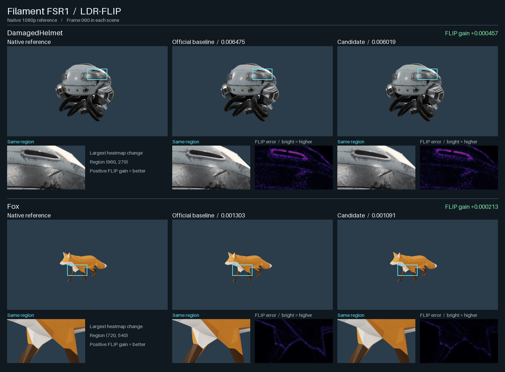

# Directional bilinear upscaling on Android Mali

The candidate came from a separate LLM4AD Next evolution run. It replaces the
single-pass reconstruction in `FsrEasuL` with one phase-adjusted bilinear
sample on flat regions. At stronger gradients, it takes two additional
samples along the dominant axis and applies a bounded RGB correction.
The patch is based on the exact Filament v1.75.0 revision used in the
measurements. [Shader patch](https://github.com/dadastory/filament/commit/9b284753f023d694a12ff484789ffca7070079f8)

## Test setup

- Android Vulkan on one Mali-G925-Immortalis MC12 device (MT6991).
- Filament v1.75.0 at `0e58877c09afb1aacd09ff640f74d2adcd2a7e80`.
- The upstream DamagedHelmet orbit and Fox Walk, with a fixed 2/3 internal
  render scale and a 1920 × 1080 output.
- 30 warmup frames and 120 timed frames per invocation. P50 is the median
  of Filament's whole-frame `Renderer::FrameInfo.gpuFrameDuration` samples.

Both mobile material wrappers compile for OpenGL and Vulkan with the v1.75.0
host tools. All four single-pass Vulkan shader disassemblies from the published
source match those of the timed material. The original fragment SPIR-V
contains five explicit texture samples and twelve gathers. The candidate
contains three explicit samples, two of which are on the detail path.
[Original SPIR-V](stock-fragment.spvasm) · [Candidate SPIR-V](candidate-fragment.spvasm)

## Follow-up timing and visual comparison

The evolution run selected the candidate at 7.76% lower aggregate P50.
The follow-up ran stock and candidate interleaved. For each candidate run
we interpolated the stock P50 between the preceding and following stock
runs by run position. Several stock measurements varied substantially.
The table uses brackets in which the two stock P50 values differ by at
most 5% of their mean. The CSV records all eight candidate comparisons and
shows which four contribute to the summary.

| Scene | Retained P50 reductions | Median reduction | Mean LDR-FLIP, stock → candidate |
| --- | ---: | ---: | ---: |
| DamagedHelmet | +1.43%, +6.29% | +3.86% | 0.008182921 → 0.007537419 |
| Fox Walk | +0.54%, +3.99% | +2.27% | 0.001267371 → 0.001070735 |

The average of the two scene medians is **3.06% lower GPU frame time** in
this follow-up. This is a small sample on one device. Qualcomm / Pixel 4
and the split-pass runtime path still need validation.

We compared 12 aligned frames per scene with the corresponding native
1080p renders using LDR-FLIP at 67 pixels per degree. Every sampled
frame had lower FLIP error with the candidate. The candidate changes
individual pixels, as the ImageDiff report shows.

- [Retest comparisons](retest-pairs.csv) and [raw retest frame timings](retest-frame-timings)
- [Original evolution measurements](original-metrics.json) and [raw original frame timings](original-frame-timings)
- [Per-frame LDR-FLIP](flip-v175.json) and [ImageDiff](original-imagediff.json)



## Reproduce the measurement

Build the [Android harness and fixtures](../../README.md#reproduce-the-v1750-run).
Use the shader in the linked patch to compile `candidate.filamat` against the
v1.75.0 materials. Run the same stock and candidate scene on one device,
alternating their order. A run with no final argument uses the stock
material baked into `runner`. Supply `candidate.filamat` as the last argument
to test the candidate.

```sh
LLM4AD_FSR_TIMINGS_ONLY=1 assets/runner assets/DamagedHelmet.glb assets/environment.ktx . DamagedHelmet
LLM4AD_FSR_TIMINGS_ONLY=1 assets/runner assets/DamagedHelmet.glb assets/environment.ktx . DamagedHelmet ./candidate.filamat
```

The harness prints 120 ordered `GPU_FRAME_NS` samples. The timing log names
retain their original run positions. Other candidates from the same timing
session occupied the intervening positions. For the quality report, use the
FLIP-enabled harness with `measure.sh` as described in the linked setup.
